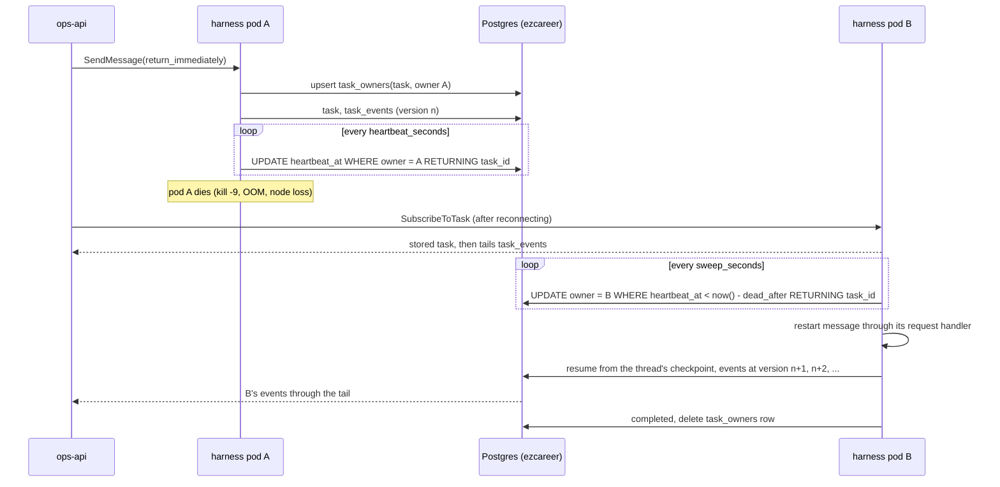
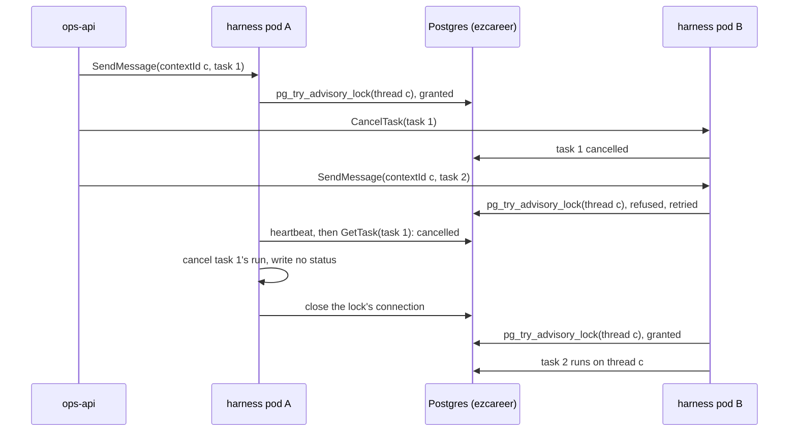

# ezcareer-harness architecture

ezcareer-harness serves career agents and workflows over A2A. Ops (ops-api and ops-web) is its only client. Read this page before you change how the harness is put together: its layers, agents, workflows, tools, skills or the A2A contract. Follow [the coding guidelines](../development/coding-guidelines.md) for the code itself.

## Layers

| Folder               | Holds                                                                                                                                                                                                       |
| -------------------- | ----------------------------------------------------------------------------------------------------------------------------------------------------------------------------------------------------------- |
| `src/app`            | The A2A server, the dependency-injector containers, `Executable`, which serves a graph at `/ezcareer/a2a/<name>`, task ownership and takeover (`Ownership`) and the thread summary API (`src/app/threads`)  |
| `src/core`           | Settings (`config.toml`, environment), errors, and `UsageReporter`, the callback that reports each model call's usage                                                                                       |
| `src/agents`         | One folder per agent: `profile.yaml`, `prompts/system.md`, `skills/`, `state.py`, and the agent's own `tools/` and `checks/`. Also `build_agent`, `AgentOverride`, `read_prompt` and the shared middlewares |
| `src/features`       | One folder per workflow: `graph.py`, `nodes/`, `checks/`, `schemas.py` and `harness/configurations.yaml`                                                                                                    |
| `src/tools`          | Tools that more than one agent uses, such as `read_profile_facts` and `clarify`                                                                                                                             |
| `src/clients`        | Clients of other services, and the LLM providers                                                                                                                                                            |
| `src/shared`         | Types and helpers that several layers use, such as the profile, job postings and checks                                                                                                                     |
| `src/infrastructure` | Observability, and persistence: the Postgres engine and pool the stores use, and the `task_owners` table                                                                                                    |

Import rules:

- `agents`, `clients`, `shared` and `tools` never import `features`.
- A feature never imports another feature. The one exception is `find_jobs`, which runs `analyse_job` through its package barrel.

`tests/test_architecture.py` enforces both rules.

## Prompts

System prompts are plain Markdown files, never text in Python, so a developer finds them beside the agent they belong to, and Harness² can rewrite them. A tool's description and error messages, and a failure reason the user sees, stay in the code they belong to.

- An agent's system prompt is `src/agents/<agent>/prompts/system.md`. When an active `prompts/system.<provider>.md` exists for the agent's LangChain provider, such as `system.anthropic.md` or `system.openai.md`, the agent uses it instead. The provider follows the model family the agent's `[[agents]]` entry in `config.toml` names, not a model picked for one run. glm models run on the `openai` provider, so a glm agent and an openai agent share `system.openai.md`. An archived variant is skipped, and the agent uses `system.md`.
- Each prompt file starts with YAML front matter: `version`, `description`, `author`, `date` and `status` (`active` or `archived`). `version` is a quoted string, such as `"1.10"`. An unquoted number is refused, because YAML would read `1.10` as 1.1. `read_prompt` validates the front matter and returns only the text after it. A file without valid front matter, or an archived one, fails the agent's build.

`Agent.hash` covers the agent's folder, so the trace's `agent_hash` changes when any of its files changes. `scripts/probe.py`'s harness hash covers it too.

## Agents and workflows

The harness serves two kinds of graph over A2A:

- **An agent**: one deep agent the user talks to, built by `build_agent`.
- **A workflow**: a LangGraph graph that runs an agent as one of its nodes, to make a run deterministic.

An agent can also run another agent as a sync subagent, inside its own run (see [Subagents](#subagents)).

| Agent                  | Workflows it runs                                                  | Served as                                   |
| ---------------------- | ------------------------------------------------------------------ | ------------------------------------------- |
| job-analyst            | `analyse-job`, `find-jobs`                                         | an agent                                    |
| career-consultant      | `write-networking`                                                 | an agent, and a subagent of career-director |
| career-director        | none; runs the others as tools; `update-profile` skill             | an agent                                    |
| productivity-assistant | `triage-email`, `draft-reply`                                      | not served; a subagent of career-director   |
| document-analyst       | `import-resume` (`src/features/import_document`), `import-profile` | not served; only its workflows are          |

productivity-assistant reads the emails of the user's job search, says what is on the user's calendar and drafts the user's replies. It never sends anything. career-director gives it a task with `assign_productivity_assistant_task` when the user asks about their email or calendar. It works with tools it owns:

- `search_threads` finds threads.
- `read_thread` reads one thread. It shows only the latest `max_thread_messages` messages (6), each cut at `max_message_chars` (4000) and marked `[cut]`, and says how many earlier ones are left out.
- `read_free_slots` lists the earliest `max_free_slots` times the user is free (12), in their time zone.
- `find_events` lists the events on the user's calendar from the start of today for `days` days (1 to 31, 7 by default). It starts with today's date and the user's time zone, which the agent doesn't otherwise know, and gives each event's time in that zone. Event titles and locations come from other people's invites, so they sit inside `<events untrusted>`.

The three limits are under `[email]` in `config.toml`.

career-director reads the user's tracked applications with `find_applications` and the jobs on their Jobs page with `find_saved_jobs`. Each returns the counts ops-api computed, a `total` and one count per stage or status, so the model reports numbers and never counts a list itself. `find_applications` gives each next step's time in the user's time zone. An application's interviews and deadlines are its steps, so career-director answers those itself, and productivity-assistant answers what is on the calendar.

For a change to a résumé, CV or cover letter, career-director finds the documents with `find_documents`, and the job with `find_saved_jobs` when tailoring, then gives career-consultant one task per document with `assign_career_consultant_task` (see [Subagents](#subagents)). Each document's proposed changes wait for the user's review in its editor.

`search_threads` filters by the days a message was sent (`since`, `until`), a keyword, a sender and whether a thread has an attachment. It shows the agent at most `max_threads` threads (20, under `[email]` in `config.toml`), inside `<threads untrusted>` like a thread the agent reads. When more match, its result ends with how many were left out and tells the agent to ask the user to narrow the search.

`draft-reply` is the deterministic version, which Ops' Inbox calls directly with the thread and free slots. It answers a thread, or writes a follow-up for an application when there is no thread. It runs productivity-assistant with only `read_profile_facts` allowed, and offers free slots by id, so code returns only slots the user has free and its `slots` check holds. Its `configurations.yaml` sets the same three limits as `[email]` for what reaches the agent.

`triage-email` uses its model only to read a thread. Code matches the thread to an application by the company it names, narrowed by role, and keeps `decide_by` only for an offer and `interview` only for a confirmed interview.

document-analyst only structures what it is given: a résumé's lines or a profile export's records. `import-resume` picks the draft's look in code: its `extract` node measures the file's layout (`layout.py`: columns, rules, tinted strips, a coloured band, a photo, the body font and the name's colour) and suggests the closest document-renderer template. The draft is made in that template, and the result's `suggestion` names it with the columns and traits it rests on.

`import-profile` turns a profile export into profile facts. ops-api unpacks the export, such as a LinkedIn data-export .zip, and sends its profile files as `files`, each with its `name` and its `rows` by column header. The reply is the run's output: `about` (headline, summary, location and up to three labelled links), `entries` (roles, education and projects) and `skills` (name and group). document-analyst's judgement is only in splitting a description into a `summary` and `highlights`, labelling links and grouping skills. Every other value is copied. Dates are `YYYY-MM`, or `YYYY` when the row gives only the year, so ops-api can match them to the profile's months. The `verbatim` check makes sure each copied value is word for word somewhere in the export. A reply that fails goes back with its errors until the recursion limit leaves no round to check, and then the run fails. Matching the import against the user's existing profile is ops-api's job. A résumé needs no workflow of its own for this: ops-api maps `import-resume`'s output to profile facts.

`write-networking` writes the job portal content that Ops' Networking tab shows: a headline, a summary and a description of each role and project, to paste into job portal and networking profiles so recruiters looking for the user's kind of role find them. It isn't tailored to one job posting. It takes every profile fact in `profile_facts`, including those the user switched off for the assistant, the user's `profession`, and optionally `only`, the one field to write: `headline`, `summary` or a role or project fact's id. Role and project facts are those whose ids start with `role-` and `project-`. career-consultant writes it after loading its `write-job-portal-content` skill, with only `read_profile_facts` allowed. Each field lists the ids of the facts it rests on in `fact_ids`. Three checks verify the answer:

- `coverage`: each field asked for is there, and each description is of a role or project.
- `citations`: each cited fact exists.
- `form`: each field keeps to its cap in `configurations.yaml` (headline 220 characters, summary 2600, description 2000), and is plain text, with bullets as `•`.

career-consultant edits one résumé, CV or cover letter, the one its state's `document_id` names. Ops' document chat and job tailoring send `document_id` in the run's input on every turn, and career-director's `assign_career_consultant_task` puts it in the subagent's input. `document_id` is required in its input, so a run served without one fails with `Invalid input`. ops-api sends no files, so the document prints without them, and a document with an asset, such as a photo, isn't printed at all. Its own pieces keep every edit checked and fitted:

- `read_document` asks ops-api for the document's current draft and PDF lines with the `read_document` [tool](#tools-ops-api-executes). It returns the draft, each line's id and text and the document's `job_id` to the model, wrapped in `<document untrusted>`, and writes the document, the full lines, the `document_id` it read for and the document's title into the state's `document`, `pdf_lines`, `document_read_for` and `document_title`, so the checks and the page fit use the version last read. The system prompt says to read the document before editing it and again before each new proposal.
- `copy_for_job(job_id, start_over=False)`, the skill tool of the `tailor-to-job` skill, asks ops-api for the job's copy of the state's document, for a job on the user's Jobs page. It returns the copy's id, draft and each PDF line's id and text in `<document untrusted>` and the job's posting in `<job untrusted>`, and switches `document_id`, `document`, `pdf_lines`, `document_read_for` and `document_title` to the copy. ops-api makes the copy when the job has no document of that kind yet. When the job already has one, ops-api returns that copy instead. With `start_over`, it first keeps that copy's draft as a version the user can restore, then replaces the draft with the state's document. When the document is already that job's, as the Jobs page's copies are, ops-api returns the document itself and the agent keeps working on it. With `start_over` there, ops-api replaces the copy's draft with the document it was copied from, which may not be a master. The tool's answer says whether ops-api made a new copy for the job or returned the job's existing one, and, when `start_over` made a new copy, that there was no copy to start over. Starting over rejects the copy's pending changeset, which no longer fits the new draft, and the tool's answer then says so. The id ops-api gets comes from the tool call's id, so asking twice returns the same copy and resets a copy at most once. The skill says to use `start_over` only when the user asks to start the copy over, and to take the job's id from `read_document`'s `job_id` when the document already belongs to a job. It is the only career-consultant tool that shows a job posting.
- `propose_changeset` runs the edit checks and returns their errors for the agent to fix. The checks refuse edits that don't apply, a change to the photo or the signature, a value that cites nothing or an unknown source, and an edit that leaves the document as the changeset's earlier edits left it (`no_change`, "this edit changes nothing"). That is judged against the draft as read, not against edits still pending in another changeset. Once a changeset passes, it prints the document through artifact-service and deletes untouched bullets, from the entry with the most and never an entry's last, until the edited document prints on no more pages than before, at most `[page_count_preservation] max_bullet_trims` (5) of them. With `enabled = false` it keeps the changeset as the agent wrote it, without printing. A document with assets is never printed either, as artifact-service needs their bytes, which the harness doesn't have: the changeset is proposed as written, and the tool's answer, "proposed, but the page count wasn't checked because the document has an image", lets the agent tell the user. It returns a tool error telling the agent to read the document first, as `list_design_options` does, when the state's `document` wasn't read for the current `document_id`: before any read, or when the editor chat's next turn sets `document_id` back to the thread's document after `copy_for_job` switched to a copy. The checks and the page fit run as a LangGraph `@task`, so resuming the tool reuses their result instead of printing again. This holds only when career-consultant is served on its own: as career-director's subagent, LangGraph resumes career-consultant's nested graph without its finished tasks, so they run again. The changeset's id comes from the tool call's id, so it stays the same either way. It then asks ops-api to save the changeset with the `propose_changeset` [tool](#tools-ops-api-executes), and publishes a `changeset` artifact `{"document_id", "changeset_id"}` with the id ops-api saved it under. When ops-api refuses, the agent gets `[{"error": ...}]` like a check error.

Both page-fit settings are under `[page_count_preservation]` in `config.toml`. The `recursion_limit` (40) in career-consultant's `profile.yaml` stops each turn of career-consultant after that many steps, served on its own or as career-director's subagent.

## Subagents

career-director is the only agent the user talks to in Ops' dock. It runs career-consultant and productivity-assistant as sync subagents inside its own run, like deepagents' `task` tool but with no state passed between them, with one tool each in `src/agents/career_director/tools/`:

- `assign_career_consultant_task(document_id, description)` and `assign_productivity_assistant_task(description)` each invoke the subagent's agent, the one instance its container builds, inside the tool call, with career-director's config.
- **What a subagent starts with.** Its only message is `description`, which career-director writes as the complete task. career-consultant also gets `document_id`, and both get the user's `profile_facts`, which their tools read. A subagent gets nothing else of career-director's state.
- **What comes back.** Only the subagent's final message, as the tool's ToolMessage. career-consultant's prompt has that reply say plainly whether it proposed edits, on which document, with any note `propose_changeset` returned, and whether it made or reused a job's copy, started it over and so rejected a pending proposal. career-director's prompt has it sum up each task from that reply alone, passing on every note the reply reports. career-director puts every change for one document into one task. None of the subagent's state is merged into career-director's. The step detail is the title of the document career-consultant last read, from its state's `document_title`, or none when it never read one, and `email` for productivity-assistant.
- **A deliberate departure from deepagents.** deepagents' `task` passes the parent's state into the subagent and merges the keys the subagent changed back into the parent. These tools do neither, so parallel tasks can't clash on `document_id`.
- **Step limit and failure.** Each subagent runs with its own profile's `recursion_limit`: 40 for career-consultant. productivity-assistant's profile sets none, so it keeps deepagents' 9,999. Any error from a subagent's run, such as running out of steps, a model provider error or a refused data request, fails only its own tool call, with a tool error saying the task isn't done. The other tasks and career-director carry on. A pause or a cancel still stops career-director's run.
- **Memory.** None. Each call starts fresh, LangChain's default for a subagent: the subagent's checkpoints live under its tool call's namespace in career-director's thread, so they serve its own pauses and a takeover, never a later call. They stay in the dock's thread after the task ends, as the thread's checkpoints are never pruned.
- **Pauses.** A subagent's interrupts, its data requests and its widgets, pause career-director's run, and ops-api answers them as for any turn. Two subagents paused at once pause the run with both requests.
- **Parallel tasks.** `create_agent` runs each tool call of a reply as its own task, so the tasks of one reply run in parallel and each step ends as soon as its subagent finishes. A second `assign_career_consultant_task` for a `document_id` that an earlier call of the same reply already names returns a tool error and doesn't run. The tool decides this from the reply's tool calls alone.
- **Stop and takeover.** `CancelTask` cancels the run and every subagent running in it. A takeover resumes from the thread's checkpoint: a finished step keeps its result and doesn't run again, and an unfinished subagent resumes from its own last checkpoint. Inside a subagent's paused step, though, LangGraph runs the step's finished tasks again alongside the paused one. Their writes are idempotent, as the ids their data requests send come from their tool calls' ids. `EventRelay` publishes their changesets again, so ops-api announces each changeset only once per turn and the dock shows no duplicate card.
- **Streaming.** Only career-director's own text streams as `thinking` and `text`. A subagent's nodes stream as steps nested under its tool call's step, but its text and its tool calls don't reach the dock. Its tools' artifacts do, as [tool artifacts](#streaming) of the dock's task, so each changeset a subagent proposes shows in the dock as proposed edits. ops-api keeps every changeset a turn proposes on that turn's message, so the cards come back after a reload. The dock reads each card's edit count and status from the document's changesets, live and after a reload alike, so a card shows `N edits to review` while its changeset is pending and says when it was accepted or rejected, whether by the user or by `copy_for_job`'s `start_over`. While a subagent runs, the dock lists its step as running, with the title of the document its `document_id` names, and the step's detail once it ends. A task that fails stays listed as failed. Once the turn ends, the timeline still lists every task, failed ones included, with the step's detail, or else the title of the document its `document_id` names. The dock orders a turn's cards by when each changeset was stored, live and after a reload alike. The timeline lists its tasks in the order they started.

Build a subagent's container before career-director's, so career-director's tools run the agent with the model the container was given.

## Agents own their tools and skills

An agent is everything it needs to do its job. Each agent is built once by `build_agent` in its container. The table above says which are also served as agents of their own. Every workflow that uses the agent runs that same instance.

An agent has two kinds of tools:

- **Always-on tools** go in `build_agent(tools=...)`. The model sees them on every call.
- **Skill tools** go in `build_agent(skill_tools=...)`. The model sees one only after it reads a skill whose `SKILL.md` lists the tool, and only while that read stays in context. Before that, a call to the tool fails as an unknown tool.

A skill lists its tools in its frontmatter, as deepagents' `SkillsMiddleware` expects:

```yaml
---
name: search-jobs
description: Turn the user's profile and preferences into a few search_jobs queries.
metadata:
  include_tools: search_jobs
---
```

Make a tool a skill tool when only one skill uses it. Otherwise keep it always-on.

A tool that one agent uses lives in `src/agents/<agent>/tools/`. A tool that several agents use lives in `src/tools/`. The container builds the tool and passes it to `build_agent`. An agent's `profile.yaml` can replace a tool's description under `tool_description_overrides`. This works for both kinds of tools.

`tests/app/test_agent_tools.py` checks every agent:

- Each tool of any agent that its system prompt or a skill names in backticks belongs to that agent.
- Each name under `include_tools` is one of the agent's skill tools.
- Each skill tool is listed by at least one skill, so the model can reach it.

## An agent works on its own

Called directly with its state in the A2A data part, an agent does its whole job. A workflow wraps it only to make a run deterministic: it loads the data, runs fixed steps and checks the result. It never supplies something the agent needs to work.

The direction is one way: a workflow runs an agent, and an agent never runs a workflow built on itself. productivity-assistant drafts a reply with its own reads, and `draft-reply` wraps it for Ops' Inbox.

So whatever an agent's model must see comes from its state or the agent itself. career-consultant's state names its document, whether Ops' document chat called it or career-director gave it a task, and its `read_document` tool reads it.

## Workflows own no tools

A workflow is a LangGraph graph that runs an agent as one of its nodes. It doesn't define, build or add tools, and `src/features/<feature>/` has no `tools/` folder. `tests/test_architecture.py` fails if one appears.

A workflow sets up its call to the agent with `AgentOverride`:

```python
agent.with_config(
    AgentOverride(
        response_format=JobRequirements,
        tools=frozenset({"read_profile_facts"}),
    ).config()
)
```

- `response_format` is the structured reply the workflow wants. It must be one of the agent's `response_formats`.
- `tools` is a whitelist of the agent's own tools, by name. `None`, the default, allows them all. The whitelist covers both always-on tools and skill tools. A name that the agent doesn't have fails the run.

`ToolAllowlistMiddleware` applies the whitelist to always-on tools with LangChain's `wrap_model_call` and `request.override(tools=...)`. The resolver that `build_agent` gives `SkillsMiddleware` applies it to skill tools. The deepagents file tools that read skills are never whitelisted out.

## Tools ops-api executes

The harness keeps no data of its own, only the A2A task store, LangGraph checkpoints and which process runs each task (see [Persistence and restarts](#persistence-and-restarts)), and no third-party credentials. When a node or tool needs something that Ops owns, it pauses the run and asks ops-api to execute a tool:

```python
interrupt({"execute_tool": "thread", "id": thread_id})
```

The A2A task becomes `input-required`, and its message carries the request as a data part. The part's metadata holds the interrupt's id, `{"interrupt_id": ...}`. When the model calls several such tools at once, such as one search per country, the message has one part per call. ops-api executes every tool for the run's user, together, and resumes the task with one data part per result, each with the `interrupt_id` of the call it answers in its metadata. The harness resumes the graph with `Command(resume={interrupt_id: result})`, so each call gets its own result. A result is `{"error": ...}` when ops-api can't execute the tool. When a tool's handler raises, ops-api logs the error with its traceback at once and answers `{"error": "Ops failed to execute <tool>"}`, so the agent carries on and the turn ends normally. These tools exist today:

- `{"execute_tool": "propose_changeset", "document_id": ..., "changeset": ...}`, from career-consultant's `propose_changeset` tool. ops-api saves the changeset as the document's pending one and returns `{"changeset_id": ...}`, or `{"error": ...}` when it doesn't fit the draft.
- `{"execute_tool": "documents", "name": ..., "kind": ...}`, from career-director's `find_documents` tool. ops-api returns `{"documents": [...]}`: the matches, best first, each with its `id`, `kind`, `title`, `master` and `updated_at`.
- `{"execute_tool": "read_document", "document_id": ...}`, from career-consultant's `read_document` tool. ops-api returns `{"title": ..., "document": ..., "pdf_lines": [...], "job_id": ...}`, the document's title, its current draft, the lines it cites, empty when it wasn't imported from a PDF, and the id of the job it is a copy for, null when it isn't a job's copy, or `{"error": ...}` when the document isn't the user's.
- `{"execute_tool": "copy_for_job", "document_id": ..., "job_id": ..., "start_over": ..., "copy_id": ...}`, from career-consultant's `copy_for_job` tool. ops-api returns `{"title": ..., "document_id": ..., "document": ..., "pdf_lines": [...], "job_id": ..., "job": {...}, "made": ..., "rejected_changeset": ...}`: the job's copy, with its title, the lines of the document it was copied from and its job's id, the job's title, company, location, URL and analysed requirements, whether `copy_id` made the copy rather than returning one the job already had, and whether starting over rejected the copy's pending changeset. When the job has no document of that kind, ops-api copies the document for the job under the id `copy_id`, linked to the job as the Jobs page's copies are. When it has one, ops-api returns that one. With `start_over`, ops-api first keeps that copy's draft as a version under the id `copy_id`, then replaces its draft with the document's. A copy, the Jobs page's included, records the document it was copied from as its source, or that document's own source when the document is a job's copy, such as a job's copy set as master, so a copy's lines are its source's. When the document is the job's copy itself, ops-api resets it the same way from the document it was copied from. Before a reset, ops-api rejects the copy's pending changeset, as the user's reject does. The copy keeps its id. The same `copy_id` returns the same copy, only when it was copied from that document, or that document's source, for that job, and resets a copy only once, as the kept version shows it already did. A document already linked to the job comes back itself, with no copy made, so the Jobs page's tailoring turn keeps working on its copy. It returns `{"error": ...}` when the document or the job isn't the user's, or for `start_over` on a job's copy whose source document was deleted. It returns a Conflict error when the user already keeps the most documents of that kind, and when another request made the job's copy of that kind at the same moment.
- `{"execute_tool": "thread", "id": ...}`, from productivity-assistant's `read_thread` tool. ops-api returns `{"thread": ...}`, or `{"error": ...}` when it can't.
- `{"execute_tool": "free_slots", "days": ...}`, from productivity-assistant's `read_free_slots` tool. ops-api returns `{"free_slots": [...], "timezone": ...}`, with no slots when the user offers none.
- `{"execute_tool": "events", "days": ...}`, from productivity-assistant's `find_events` tool. ops-api returns `{"events": [...], "timezone": ..., "today": ...}`: the events, not cancelled, that overlap the `days` days from the start of today, earliest first, in the user's time zone or the calendar's until they choose one. It returns `{"error": ...}` when it can't read the calendar, for example when Google isn't connected.
- `{"execute_tool": "applications", "company": ..., "stage": ...}`, from career-director's `find_applications` tool. ops-api returns `{"by_stage": {...}, "applications": [...], "timezone": ...}`. `by_stage` counts every stage of the applications whose company contains `company`, ignoring case, or of all of them when it is `null`. `applications` are those that also have `stage`, overdue first, then soonest next step first, each with its company, role, stage, applied day, fit, next step and overdue steps.
- `{"execute_tool": "saved_jobs", "company": ..., "status": ...}`, from career-director's `find_saved_jobs` tool. ops-api returns `{"by_status": {...}, "jobs": [...]}`. `by_status` counts every status (`picked`, `saved`, `dismissed`) of the jobs whose company contains `company`, ignoring case. `jobs` are those with `status`, or the picked and saved ones that the Jobs page shows when it is `null`, best fit first, each with its `id`.
- `{"execute_tool": "threads", "since": ..., "until": ..., "keyword": ..., "sender": ..., "has_attachment": ..., "limit": ...}`, from productivity-assistant's `search_threads` tool. Each filter is `null` when the agent didn't set it. `since` and `until` are ISO dates and include their day. `sender` matches a name, an address or a domain. `limit` is the most threads to send.

  ops-api returns the matching threads, latest first and at most `limit`, and how many match in all:

  ```json
  {
    "threads": [
      {
        "id": "t-1",
        "subject": "Your interview with Acme Payments",
        "sender": "Priya Shah <priya@acme.com>",
        "last_sent_at": "2026-11-09T09:12:00Z",
        "message_count": 2,
        "has_attachment": false
      }
    ],
    "total": 1
  }
  ```

  `sender` and `last_sent_at` are the latest message's. It returns `{"error": ...}` when it can't search, for example when the user's inbox isn't connected.

- `{"execute_tool": "profile_sync", "document_id": ...}`, from career-director's `preview_profile_sync` tool. ops-api dry-runs its profile import of that résumé or CV and returns `{"edits": [...]}`, the edits that would bring the profile in line with it. It saves nothing, and returns `{"error": ...}` when the document can't be synced.
- `{"execute_tool": "profile_update", "edits": [...]}`, from career-director's `update_profile` tool, only after the user approves the call (see [Approvals](#approvals)). ops-api saves all the edits or none and returns `{"saved": ...}`, or `{"error": ...}`.

  Each edit has a `kind`: `about` sets one about field, `entry` sets one field of a role, education or project by its fact id, and `new_entry`, `new_skill` and `new_link` add one. `src/agents/career_director/types.py` defines them as `ProfileEdit`.

- `{"execute_tool": "job_search", "query": ..., "location": ..., "country": ..., "remote_only": ..., "posted_within": ..., "employment_types": [...], "job_requirements": [...], "radius_km": ..., "max_jobs": 10}`, from job-analyst's `search_jobs` tool. `max_jobs` is always 10, so a result fits in one tool message: deepagents moves a tool result over 20,000 tokens to a file the model can't read whole. The agent sees each job under a short id, `job-` and the first 8 hex characters of the SHA-256 of the source's id, because a source's ids are too long to copy: JSearch's are 414 characters. find-jobs' check and output map the short id back to the posting, so ops-api gets the source's id. The other fields are the tool's arguments, with each field of the user's own search (`query`, `location`, `posted_within`) that is set and not empty over the agent's. The request names no job source: ops-api chooses one (today JSearch, on the user's own key) and returns `{"jobs": [...], "requests_left": ...}`. `jobs` are `JobPosting`s, newest first, each job once, and without jobs that break the user's work mode or country preferences. `requests_left` is how many requests the user's key has left, or `null` when the source didn't say. ops-api returns `{"error": ...}` when it can't search, for example when the user hasn't connected a job search key in Settings or the source is down. `search_jobs` gives the agent that error as a tool error, and the agent goes on with the jobs earlier searches found. find-jobs fails with the errors when no search succeeded, so career-director's `find_jobs` tells career-director why.
- `{"execute_tool": "job_run", "run_after": ..., "search": ...}`, from career-director's `schedule_job_run` tool. `run_after` is an ISO 8601 time with its offset, or `null` to run as soon as a worker is free; `search` is a `JobSearch` (`query`, `location`, `posted_within`), or `null` to search from the user's preferences. ops-api queues a run of its job agent and returns `{"id": ..., "run_after": ...}`, or `{"error": ...}` when it can't, for example when an agent run is already queued. No approval is needed: the run only adds jobs for the user to look at.

A question for the user, from `clarify` or `choose_document`, pauses the run in the same way, with a widget instead of `execute_tool`. ops-api answers a widget, or sends the user's next message to a paused task, without an `interrupt_id`. The harness then reads the pending interrupts from the thread's state, which includes those raised inside a subagent, and resumes with `Command(resume={id: answer})` for the first one. The task's message lists a pause's questions before its `execute_tool` requests, so the first part is the question a bare answer goes to. A bare `Command(resume=answer)` would be kept on the thread and handed again to the next interrupt of the same task, such as a subagent's, so a later request would get the old answer instead of pausing.

## Approvals

A tool that writes the user's data runs only after the user approves the call. `build_agent(interrupt_on=...)` passes the tools that need approval to deepagents, which adds LangChain's `HumanInTheLoopMiddleware`. career-director needs approval for `update_profile`, with the decisions approve and reject.

When the model calls such a tool, the run pauses before the tool runs. The A2A task becomes `input-required`, and its message carries the middleware's request as a data part:

```json
{
  "action_requests": [
    {
      "name": "update_profile",
      "args": { "edits": [...], "source": "Backend résumé" },
      "description": "..."
    }
  ],
  "review_configs": [
    { "action_name": "update_profile", "allowed_decisions": ["approve", "reject"] }
  ]
}
```

ops-api resumes the task with one decision per action request, in order: `{"decisions": [{"type": "approve"}]}`, or `{"decisions": [{"type": "reject", "message": ...}]}`. On approve the tool runs, so `update_profile` then asks for `profile_update`. On reject it never runs, and the model gets the rejection, with the user's message when there is one.

## Run metadata

A request's `params.metadata` sets up one run. `LanggraphExecutor` validates it as `RunMetadata` and hands it to the graph as the `RunContext` runtime context:

- `model` picks the model every LLM call of the run uses. `dynamic_model_call` applies it. Without it, each agent keeps its own.

The executor saves the validated metadata and the executable's name in the task's metadata, so a restart can resume the task as it was.

Metadata carries no credentials, and `RunMetadata` refuses any other field. The harness holds no third-party key apart from its own model keys: a tool that needs the user's account, such as Gmail or a job search, asks ops-api to execute a [tool](#tools-ops-api-executes), and ops-api makes the call.

## Conversations

A served agent (`kind="agent"`: career-director, career-consultant and job-analyst) keeps a conversation's whole state on the harness for the conversation's life, the LangGraph way: its checkpoint thread is the A2A context id, as in LangGraph's own Agent Server A2A endpoint. ops-api keeps one context per conversation. career-director's dock has one per user, and the editor chat has one career-consultant thread per document. The thread keeps the messages with their tool calls and results, the summary, career-consultant's document and a subagent's checkpoints while its task runs. ops-api keeps its own copy of the messages to show, synced turn by turn. A workflow keeps one checkpoint thread per A2A task.


- **A turn's message.** Every new user message to an agent must carry two keys in its message metadata: `created_at`, when the user sent it, in ISO 8601 with its UTC offset, and `timezone`, the user's IANA time zone, such as `Europe/London`. A message without `created_at`, or with a `created_at` or `timezone` that does not parse, fails its task with `Invalid input`. A message without `timezone` is stamped in UTC. The executor turns the user's text into a `HumanMessage` whose id is the A2A message id, stamped with when the user sent it in their time zone: `[Fri 20 Nov 2026, 09:30 Europe/London] text`. The stamp comes from the message, not the clock, so earlier turns stay byte for byte the same and keep the prompt cache. The data part is the rest of the input and overwrites those keys of the thread's state: career-director gets the profile; career-consultant gets `document_id` and `profile_facts`.
- **Answers.** A message on a paused task answers it. The answer resumes the run only while the thread's latest checkpoint is that task's own. Once a newer message has run on the thread, the task fails with "This question was replaced by a newer message". An answer part with an `interrupt_id` in its metadata answers that pause. An answer without one answers the first pause that is not an `execute_tool` request, or the first pause when all are. The task fails with "There is no question waiting for an answer" when the thread has no pause.
- **The reply.** A completed turn's reply message has the id of the final AI message in the thread, so ops-api's copy and the harness's message share one id. A turn whose final AI message has no text fails with "The assistant stopped without replying" instead of completing with an empty reply.
- **Summaries.** deepagents' summarisation, which every deep agent has, summarises the older messages once a model call passes 85% of the model's input limit, or 170,000 tokens when the model has no profile, and summarises and retries a call that overflows. It leaves `messages` whole and records the summary in `_summarization_event`, and it moves the summarised messages to `/artifacts/conversation_history/<session>.md`, which the `/artifacts/` route keeps in the state's `files`. deepagents marks both summary keys private, which leaves them out of an agent's input and output but not out of its checkpoints, so a served agent's thread keeps its summary between turns. A subagent starts fresh on every call, so its summary lasts only for that task.
- **Summary API.** `GET` and `PUT /ezcareer/threads/{thread_id}/summary?agent=career-director|career-consultant` read and edit the summary text in that thread's state. `GET` returns `{"summary": null}` before the first summary. `PUT {"summary": ...}` replaces the text the agent sees from its next model call, and is 404 when there is none. It is 409 while a run holds the thread or the thread has a step still to run, such as a pause waiting for an answer or a step a cancel or crash stopped: writing state then would replace the checkpoint the next answer or takeover resumes from. The thread's next message clears such a step. ops-api checks the thread is the user's before calling.
- **Cancel.** `CancelTask` on a running turn stops it as LangGraph's interrupt does: the steps that finished stay in the thread. A paused task's cancel only marks the task cancelled, as a2a-sdk calls the executor only for a run in progress. Either way, the thread's next message drops the unfinished step, as LangGraph does for new input, and deepagents' `PatchToolCallsMiddleware` answers each tool call left without a result.
- **No pruning.** An agent thread's checkpoints are never deleted or pruned. deepagents keeps `messages` and `files` in `DeltaChannel`s, which save each step's writes rather than the whole value, and `AsyncPostgresSaver.aprune` refuses to prune threads that use them.

## Persistence and restarts

`stores` in `config.toml` picks where the harness keeps its state: `postgres` (the default) or `memory`, which tests and probes use. Every Postgres connection works in the `[database] schema_name` schema (`ezcareer`), on the Postgres server ops-api uses. Each new connection runs `SET search_path` itself, because Supabase's session pooler ignores a `search_path` sent at startup.

| Store            | `postgres`                                                                                      | `memory`            |
| ---------------- | ----------------------------------------------------------------------------------------------- | ------------------- |
| A2A tasks        | a2a cluster mode: `VersionedDatabaseTaskStore` (tables `tasks`, `task_versions`, `task_events`) | `InMemoryTaskStore` |
| A2A event stream | `DatabaseTaskEventStream`, which polls `task_events`                                            | none (one process)  |
| Task owners      | `PostgresTaskOwners` on the `task_owners` table                                                 | `MemoryTaskOwners`  |
| Checkpoints      | LangGraph `AsyncPostgresSaver`                                                                  | `InMemorySaver`     |

The A2A stores and the task owners share one SQLAlchemy engine. The LangGraph saver has one psycopg pool. `task_owners` is the harness's only own table: its Alembic migrations in `migrations/` create it, with their version table in the same schema. At startup the app creates the schema when missing, creates the A2A tables, opens the pool and runs the LangGraph saver's `setup()` migrations. It does not run Alembic: run `migrate` first (see [Getting started](../development/getting-started.md)).

- **Checkpoints per thread.** An agent keeps one checkpoint thread per A2A context for as long as the conversation lasts (see [Conversations](#conversations)). The executor tags each checkpoint with the A2A task that wrote it, `task_id` in its metadata. A workflow keeps one checkpoint thread per A2A task, keyed by the task id, which the executor deletes once the task completes, fails or is cancelled, or its run raises an unexpected error.
- **Checkpoint types.** Both savers read checkpoints with a `JsonPlusSerializer` whose `allowed_msgpack_modules` lists every Pydantic model and enum of the harness (`src`) and `document_schema`. Those and LangGraph's own safe types are rebuilt. Any other type comes back as its plain data and is logged as blocked, as it will be by default in a later LangGraph, so threads that last a conversation's life stay readable across upgrades.
- **Callers can leave.** A task runs on when ops-api disconnects. Only `CancelTask` stops it.
- **Any replica serves a task.** Every replica writes each task event into `task_events` in the same transaction as the task, with a version that only moves forward. `SubscribeToTask` on the replica that runs the task taps its live events. On any other replica it returns the stored task and then tails `task_events` until the task pauses or ends.

### Ownership and takeover

The harness runs as several replicas. a2a-sdk keeps each task's state but not which process runs it, and nothing in it resumes the tasks of a process that died. The `task_owners` table records who runs each task, and `Ownership` (`src/app/a2a/ownership.py`) heals the rest. Each process start has its own owner id, `<hostname>:<random>`, so a restarted pod never passes for the one before it.

| `[tasks]` setting       | Default | What it does                                                                      |
| ----------------------- | ------- | --------------------------------------------------------------------------------- |
| `heartbeat_seconds`     | 10      | How often a process sets `heartbeat_at = now()` on all its rows, in one statement |
| `dead_after_seconds`    | 30      | A row whose heartbeat is older than this belongs to a dead process                |
| `sweep_seconds`         | 15      | How often a process sweeps for tasks to take over. It also sweeps once at startup |
| `resume_window_seconds` | 600     | A taken-over agent task updated this recently resumes. An older one fails         |
| `thread_wait_seconds`   | 60      | How long an agent run waits for an earlier run on its thread to stop              |

- **Owning a task.** `LanggraphExecutor.execute` upserts the task's row with its owner id before it runs anything: a new task, an answer to a pause, or a takeover. It deletes the row when the run stops: completed, failed, cancelled or paused. A paused task needs no owner.
- **One run per thread.** An agent's run holds its thread from just after it marks its task working until it stops, as LangGraph's Agent Server allows one run per thread. In Postgres the hold is a session advisory lock, `pg_try_advisory_lock(hashtext('ezcareer thread ' || context_id))`, on an unpooled connection of its own. Closing the connection lets go of the lock, and so does the death of its process: the connection asks Postgres for TCP keepalives every 10 seconds, so Postgres drops a lost pod's session within about 25 seconds. In memory it is a set of held threads. A run whose thread another run holds tries again every 0.1 seconds, and fails its task with "An earlier message to the assistant is still running" after `thread_wait_seconds`. A stale run therefore can't write a checkpoint after a newer turn has started on the same thread.
- **Heartbeat.** Each beat returns the ids of the rows the process still owns. A run whose task is missing from them was taken over: the process cancels that run without failing the task or deleting its checkpoints. A run whose task the task store already shows as cancelled was cancelled on another replica: a2a-sdk's `CancelTask` on a replica that doesn't run the task only writes the cancelled status. The process cancels that run without writing a status, which lets go of its thread within `heartbeat_seconds`. Before a run ends its task (completes, pauses or fails it), the executor checks that it still owns the task, and stops the same way when it does not. A process that froze and woke up therefore never ends a task another process now runs.
- **Sweep.** The sweep takes over every row whose heartbeat is older than `dead_after_seconds`, in one `UPDATE … RETURNING`. Two sweepers can't both win a row: Postgres rechecks the heartbeat once the first one commits. The sweep also claims each `working` task that has no row and has not changed for `dead_after_seconds`, with `INSERT … ON CONFLICT DO UPDATE … WHERE` the row is dead. It lists tasks for the same unauthenticated caller ops-api's calls resolve to.
- **Resume or fail.** For each task it wins, the sweep sends the task a message whose metadata says `restart`, through its executable's request handler. An agent's task last updated within `resume_window_seconds` resumes from its thread's last checkpoint when that checkpoint is the task's own, and keeps writing to the same task. A run whose steps had all finished completes with its reply. The run first writes a working status with no message of its own, so ops-api's subscriber sees activity at once. An older one, one whose thread's last checkpoint is missing or belongs to a later task, or a workflow's task fails with "The assistant restarted", and its thread stays as it was: ops-api waits on a workflow in a single blocking call and never reconnects to it. A won task that is no longer working, or has no executable, just loses its row. A resume may rerun the step that was running. ops-api dedupes the writes it executes by `interrupt_id`.
- **Graceful shutdown.** On shutdown the app stops the heartbeat and the sweep, closes each request handler, which cancels its runs without failing their tasks, then backdates its rows' heartbeats by an hour. The next sweep on another process takes them over at once instead of after `dead_after_seconds`.



A cancel that lands on the wrong replica, and the next message on the same thread:



## Streaming

Each run of `LanggraphExecutor` goes through three choices, each kept in one place in `src/app/a2a/executable.py`:

- **Input.** `GRAPH_INPUTS` checks the request in order and picks how it becomes the graph's input. `Restart` takes a takeover's `restart` message, `Answer` takes a message on a paused task, and `Start` takes a new message. Each has one `graph_input` method. For `Answer` and `Restart`, whose `resumes` is true, the executor first reads the thread's latest checkpoint once, keeps its values as the run's result and passes it to `graph_input`.
- **Stream.** `EventRelay` keeps the run's latest values, its pauses, the thinking and text artifacts it opened, and the running tool calls. It handles each streamed chunk with the handler for its stream mode: `values`, `messages` or `tasks`.
- **End.** A run that paused asks for input. Otherwise `REPLIES` checks the final values in order and picks the reply: a workflow's values, the `structured_response`, or the final AI message's text. A run none of them fits fails.

Every check that stops a turn raises `ExecuteError`, and `GraphRecursionError` becomes one. The executor catches it in one place and fails the task.

ops-api starts a turn with `SendMessage` and `return_immediately`, then follows it with `SubscribeToTask`. `SendStreamingMessage` streams the same events. `LanggraphExecutor` streams the graph with `stream_mode=["values", "messages", "tasks"]` and turns it into A2A events:

- **Steps.** Each node, tool call and subgraph task is a working status update whose data part is `{"step": ...}`.
- **Resumed steps.** On a resume, LangGraph lists again the tasks of the paused step that had already finished, without running them. The executor reads which top-level tasks finished from the checkpoint it resumes and reports no step for them, so a subagent task that finished before another paused stays done.
- **Step details.** A finished step carries `detail`, a short result or target in plain words, such as `1 cover letter`. A tool sets it by returning `{"step_detail": ...}` in its ToolMessage artifact, beside `name` and `data` when it also publishes one. A tool call's step reads its own tool's detail. A node's step reads the last detail its tools set. `find_documents` sets the count by kind, `assign_career_consultant_task` the title of the document career-consultant last read and `assign_productivity_assistant_task` `email`, `copy_for_job` the job's company, and `propose_changeset` the first fact its edits cite, such as `citing Acme Payments`. A tool call's step also carries `document_id` from its start when the call's arguments name one, as `assign_career_consultant_task`'s do.
- **Usage.** Each model call that ends, in any agent, workflow node or tool's workflow, is a working status update whose data part is `{"usage": ...}`. A LangChain callback handler, `UsageReporter`, reads the call's final `AIMessage`. The part carries `provider` (the model's family in `[models]`), `model` (as `[models]` names it), `agent` (the nearest configured agent the call runs in, such as a subagent, else the executable), `node`, LangChain's `input_tokens` and `output_tokens`, `cache_read_tokens`, `cache_write_tokens`, `reasoning_tokens`, `latency_ms`, `stop_reason` and `request_id`. Tokens are 0 when the provider sent no usage, and a call that fails sends nothing. glm models set `stream_usage` so the gateway streams usage. A blocking `SendMessage` returns these messages in the task's `history`.
- **Thinking and text.** The model's reasoning and text stream as `thinking` and `text` artifacts, one per model turn. For a workflow, they come from the node that `Executable.reply_node` names.
- **Tool artifacts.** A tool that returns an artifact `{"name": ..., "data": ...}` publishes it as an artifact of that name. This holds for a top-level tool call and for the tool calls of a subagent it runs, such as career-consultant's inside `assign_career_consultant_task`. `propose_changeset` publishes `changeset` this way.
- **Reply.** The final answer is an artifact named after the executable. Then the task completes, fails, or asks for input. Each of those status updates carries an agent message whose `messageId` the task keeps, so `GetTask` after a reconnect returns the same id. A completed agent turn's `messageId` is its final AI message's id in the thread. A completed message also carries the reply.
- **Failure.** A failed task's status message carries the reason as text. When the user must add something before the run can work, it also carries a data part `{"next": {"label": ..., "screen": ...}}`, where `screen` is `portfolio`, `documents`, `jobs` or `settings`. Raise `ExecuteError(reason, NextStep(...))` to set it. `require_facts` fails analyse-job and find-jobs this way when the profile has no facts.

`CancelTask` stops a run. A workflow's checkpoints are deleted, and an agent's thread keeps what finished (see [Conversations](#conversations)).
